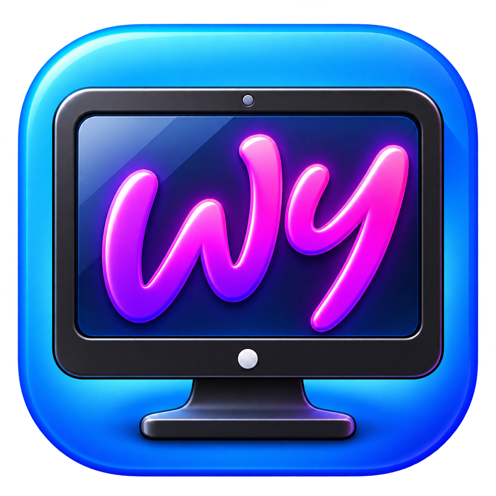

[English](README.md) | [Deutsch](README.de.md)

<p align="center"></p>
<h1 align="center">Wupsy</h1>

Wupsy bietet animierte Wallpaper, einen eingebauten Wallpaper-Editor und Desktop-Widgets für **macOS 14+ auf Apple silicon**. Erstelle und bearbeite eigene animierte Wallpaper, spiele Videos, Bilder, GIFs und lokale Webinhalte ab und ordne Widgets auf deinem Desktop an. Wupsy ist eine native SwiftUI/AppKit-App, die ursprünglich auf Ambient basiert und um einen eigenen Wallpaper-Editor sowie native Szenenfunktionen wesentlich erweitert wurde; siehe [Lizenz und Herkunft](#lizenz-und-herkunft).

**Frühe Vorabversion:** Kompatibilität und Leistung entwickeln sich noch weiter. Entwicklungsbuilds sind ad-hoc signiert, nicht mit einer Developer ID signiert oder notarisiert. Es werden keine festen Obergrenzen für CPU-Auslastung, Speicherbedarf oder Akkuverbrauch zugesagt.

## Funktionen

- Endloswiedergabe von Videos in Originalqualität, mit optionaler Balanced-/Eco-Konvertierung und einem größenbegrenzten Cache für fertig konvertierte Kopien.
- Native Bildeffekte Flow, Ripple und Clouds sowie Rain- und CursorTrail-Ebenen.
- Eingebauter Editor für native Wupsy-Projekte mit Masken, Malen von Flow-Richtungen und -Regionen, Live-Vorschau, Rückgängig/Wiederholen, Sichern und Sichern unter.
- Importe in eine verwaltete Mediathek, Favoriten, benannte Wiedergabelisten sowie manuelle Sicherung und Wiederherstellung.
- Widgets für Uhrzeit, Datum, CPU, geschätzte Speichernutzung und Netzwerk; frei anzuordnendes Desktop-Layout und eigene offline nutzbare HTML/CSS-Widgets.
- Mehrere Bildschirme, Start bei der Anmeldung, an den Ruhezustand angepasste Wiedergabe und begrenzte Wiederherstellungsversuche bei Videoproblemen.

## Eingebauter Wallpaper-Editor

Beginne mit einem eigenen PNG- oder JPEG-Bild oder öffne ein vorhandenes natives Wupsy-Projekt. Ordne Bildebenen an, verschiebe, skaliere und drehe sie und füge Flow für gerichtete Bewegung, Ripple für Wellenverzerrung oder Clouds für animierte Wolkenmuster hinzu. Male Masken, um festzulegen, in welchen Bereichen unterstützte Effekte sichtbar sind, und male Flow-Richtungen und -Regionen, um die Bewegung zu steuern. Rain und der vom Mauszeiger gesteuerte CursorTrail lassen sich als separate Ebenen hinzufügen.

Nutze die statische Arbeitsfläche zum Anordnen des Layouts und die Live-Vorschau zum Prüfen der Animation. Mit Rückgängig/Wiederholen kannst du Bearbeitungsschritte revidieren; Sichern und Sichern unter erhalten deine Arbeit als bearbeitbare native Projekte. Importierte Originale bleiben unverändert. Die [Editor-Anleitung](docs/EDITOR.de.md) beschreibt Abläufe und Einschränkungen. Der Editor arbeitet mit nativen Wupsy-Szenen; beliebige Wallpaper-Engine-Projekte werden nicht konvertiert.

## Wupsy verwenden

Erstelle die App aus dem Quellcode wie unten beschrieben. Bei einer Bereitstellung als Disk-Image kopierst du Wupsy.app nach Programme (Applications), wartest auf den Abschluss des Kopiervorgangs, wirfst das Disk-Image aus und öffnest die kopierte App. Falls macOS einen Build blockiert, dem du vertraust, nutze die Freigabe für diese einzelne App unter Datenschutz & Sicherheit; deaktiviere Gatekeeper niemals systemweit.

Wähle in der Mediathek **Hintergrundbild hinzufügen**, um unterstützte Medien, einen Webordner mit index.html oder einen nativen Ordner mit scene.wss.json zu importieren. Importe kopieren die Inhalte in Wupsys verwaltete Mediathek und lassen die Originale unverändert. Ein erneuter Import erstellt eine separate Kopie. Beim Entfernen eines verwalteten Eintrags wird seine lokale Kopie gelöscht.

Das Schließen der Mediathek beendet die Wiedergabe nicht; beende Wupsy über die Menüleiste, um sie zu stoppen.

Benannte Wiedergabelisten enthalten Mediathekseinträge; zur Aktivierung sind mindestens zwei verschiedene verfügbare Wallpaper erforderlich. Jede Wiedergabeliste hat ein eigenes Intervall und einen sequenziellen oder zufälligen Wiedergabemodus. Pausieren hält den Wechsel an. Manuelles Anwenden oder Stoppen deaktiviert den Wechsel, ohne die Definitionen der Wiedergabelisten zu löschen. Beim Löschen einer Wiedergabeliste werden ihre Wallpaper niemals gelöscht.

Aktiviere für Widgets die gewünschten Widgets, wähle **Desktop-Widgets bearbeiten**, ordne sie an und wähle **Widget-Bearbeitung beenden**. Eigene Widgets verwenden das [lokale Widget-Paketformat](WIDGETS.md).

## Unterstützte Inhalte

| Inhalt | Unterstützung |
|---|---|
| MP4, MOV, M4V | Von macOS abspielbare Codecs; H.264/HEVC empfohlen |
| PNG, JPEG, HEIC, TIFF | Statische Bilder |
| GIF | Native ImageIO-Animation |
| HTML / lokale Webordner | WebKit-Wallpaper; Skripte können auf das Netzwerk zugreifen |
| Nativer Wupsy-Ordner / scene.wss.json | Projektlokale Bilder, Masken, Felder und Regionen |
| Wallpaper-Engine-Projekte, PKG/TEX, beliebige Shader | Nicht unterstützt; keine automatische Konvertierung |

Beginne für aufgabenspezifische Dokumentation mit dem [Projektwegweiser](PROJECT.md). Siehe außerdem [Szenenunterstützung](SCENE-SUPPORT.md), [Szenenformat](WSS-SCENE-FORMAT.md), [Effektindex](WSS-EFFECTS.md) und [CursorTrail](WSS-TRAIL.md). Verwende nur Inhalte, zu deren Nutzung du berechtigt bist. Persönliche Wallpaper-Fotos und Masken sind nicht enthalten.

## Daten und Sicherungskopien

Wupsy verwendet `~/Library/Application Support/Wupsy`, `~/Library/Caches/Wupsy` und die Einstellungsdomain `com.wirdschonsoftware.wupsy`. Ambient-Daten werden weder gesucht noch migriert. Native Importe werden unter `Wallpapers/WSS/` gespeichert; Medien und Webinhalte verwenden `Wallpapers/Media/` beziehungsweise `Wallpapers/Web/`.

Mediathekssicherungen sind unverschlüsselt und können private Medien, Web-Quelldateien und Metadaten enthalten. Bewahre sie vertraulich auf. Die Wiederherstellung ersetzt die Mediathek nach Bestätigung, klärt den Zustand offener Editoren und erfordert nach der Übernahme der wiederhergestellten Daten das Beenden und erneute Öffnen der App. Ein gesichertes Wallpaper oder eine Wiedergabeliste wird nicht automatisch aktiviert. Siehe [Sicherungsformat](BACKUP-FORMAT.md) und [Sicherheit der Wiederherstellung](RESTORE-TRANSACTION.md).

## Build

Verwende Xcode mit einer über xcode-select ausgewählten Swift-6-Toolchain:

```sh
swift test --jobs 2
bash scripts/build-app.sh
open dist/Wupsy.app
```

Das Paket verwendet den Swift-5-Sprachmodus und macOS-Systemframeworks einschließlich der systemeigenen libarchive. Die Paketierung zielt auf arm64; die Bereitstellung für Intel ist nicht getestet. Die Version wird aus VERSION gelesen; die Buildnummer wird in scripts/config.sh festgelegt.

Für die optionale Paketierung als Disk-Image werden Python 3.10+ und die auf feste Versionen gesetzten Layout-Werkzeuge benötigt:

```sh
python3 -m venv .venv
.venv/bin/pip install -r scripts/requirements-dmg.txt
LAYOUT_PYTHON="$PWD/.venv/bin/python" bash scripts/build-dmg.sh
```

Siehe [Bereitstellung und Signierung](DISTRIBUTION.md). Entwicklungsbuilds benötigen keine geheimen Signierungsdaten. [Mitwirken](CONTRIBUTING.md) beschreibt Prüfungen und die Code-Struktur; die [Sicherheitshinweise](SECURITY.md) erläutern das Melden von Problemen und den vertrauenswürdigen Umgang mit Inhalten.

## Lizenz und Herkunft

Wupsy ist ein unabhängig weiterentwickelter Fork von [Ambient](https://github.com/Claude-Reverser/Ambient), ursprünglich von Claude-Reverser und weiteren Mitwirkenden. Die ursprüngliche [MIT-Lizenz samt Copyright-Hinweisen](LICENSE) bleibt erhalten. Die [Drittanbieterhinweise](THIRD-PARTY-NOTICES.md) nennen aktuelle Quellenangaben und historische Grenzen des Herkunftsnachweises. Wupsy steht in keiner Verbindung zu Wallpaper Engine, Steam oder Apple.

Für die drei ausdrücklich aufgeführten WSS-Branding-Grafiken und ihre technischen Darstellungen als Symbole beziehungsweise Hintergründe gelten gesonderte Nutzungsregeln: [Deutsch](BRANDING.md) / [English](BRANDING.en.md), mit [Brand/LICENSE](Brand/LICENSE). Unveränderte offizielle Apps, DMGs und unveränderte offizielle Quellcodekopien dürfen mit ihren Grafiken und Hinweisen weitergegeben werden. Veränderte Builds/Forks müssen diese offiziellen Grafiken ersetzen oder entfernen, sofern keine gesonderte Erlaubnis vorliegt; bereits bestehende Rechte bleiben vorbehalten. Dies schränkt weder MIT-lizenzierten Code ein noch nachträglich die Nutzung von Ambient-Assets; es werden weder exklusive Urheberrechte an KI-Grafiken noch eingetragene Markenrechte behauptet.
