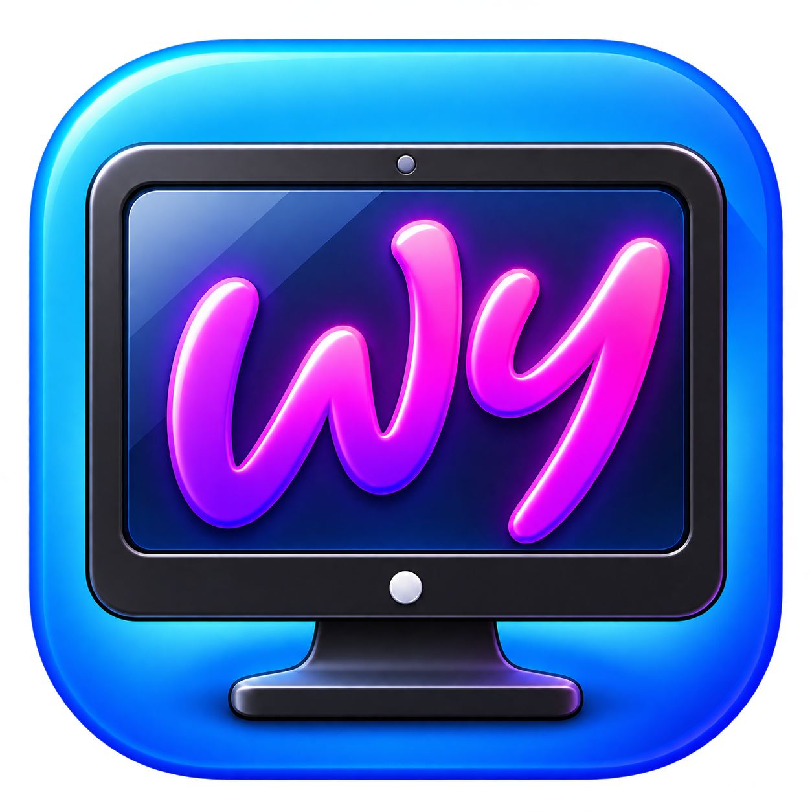

[English](README.md) | [Deutsch](README.de.md)

<p align="center"></p>
<h1 align="center">Wupsy</h1>

Wupsy ist eine native macOS-App für animierte Wallpaper, eigene Szenen und Desktop-Widgets. Spiele Videos, GIFs oder lokale Webprojekte ab, gestalte aus deinen Bildern animierte Wallpaper im eingebauten Editor und organisiere sie in einer Mediathek mit Favoriten und Wiedergabelisten.

## Download und Installation

Wupsy setzt **Apple silicon (ARM64)** voraus und ist für **macOS 14 oder neuer** ausgelegt. Praktische Prüfungen fanden unter macOS 26 und 27 statt. macOS 14 und 15 wurden nicht geprüft. Der aktuelle Download ist ad-hoc signiert und hat weder eine Apple-Developer-ID-Signatur noch eine Notarisierung.

1. Lade unter **Assets** die `.dmg` und die zugehörige Datei `.dmg.sha256` herunter. [Aktuelles GitHub-Release](https://github.com/Minischatten/Wupsy/releases/latest)
2. Wechsle im Terminal in den Ordner mit beiden Dateien und führe den folgenden Befehl aus. Ersetze `<version>` durch die Version im heruntergeladenen Dateinamen. Fahre fort, sobald die Prüfung `OK` meldet.

   ```sh
   shasum -a 256 -c "Wupsy-<version>.dmg.sha256"
   ```

3. Öffne das Disk-Image, kopiere `Wupsy.app` nach **Programme** und warte, bis der Kopiervorgang abgeschlossen ist. Wirf dann das Disk-Image aus und öffne die kopierte App. Falls macOS den Start blockiert, kannst du die App unter **Systemeinstellungen → Datenschutz & Sicherheit** freigeben.

Die folgenden Abschnitte beschreiben die aktuell veröffentlichte Version. Du kannst Wupsy auch [aus dem Quellcode bauen](#build).

## Mediathek und Desktop-Wiedergabe

- **Importieren und organisieren.** Wähle **Hintergrundbild hinzufügen** oder ziehe Dateien in die Mediathek. Durchsuche und filtere deine Sammlung, markiere Favoriten, benenne ein ausgewähltes Wallpaper mit der Eingabetaste um und ändere die gespeicherte Reihenfolge durch Ziehen der Karten. Der Import kopiert Inhalte in die verwaltete Mediathek. Ein erneuter Import legt eine separate Kopie an. Beim Entfernen eines verwalteten Eintrags wird seine lokale Kopie gelöscht.
- **Wiedergabelisten.** Erstelle benannte Listen mit eigenem Intervall und sequenzieller oder zufälliger Wiedergabe. Zur Aktivierung müssen mindestens zwei verschiedene Wallpaper verfügbar sein. Pausieren hält die verbleibende Zeit an. Manuelles Anwenden oder Stoppen beendet die Rotation und erhält die Liste. Beim Löschen einer Liste bleiben ihre Wallpaper in der Mediathek.
- **Wiedergabe.** Wende ein Wallpaper in der Mediathek an und nutze Pause oder Fortsetzen über die Menüleiste. Stopp ist in der Mediathek verfügbar. Beim Schließen der Mediathek läuft die Wiedergabe weiter. Beende Wupsy über die Menüleiste, um sie zu stoppen. Bei geeigneten Bild- und WSS-Wechseln behält Wupsy bei einem Vorbereitungsfehler das bisherige Wallpaper bei. Bei Problemen kann die Videowiedergabe begrenzte Wiederherstellungsversuche ausführen.
- **Displays und Einstellungen.** Nutze das Hauptdisplay oder aktiviere **Alle Displays**. Die Wiedergabe reagiert auf Ruhezustand und Aufwachen. In den Einstellungen findest du die Pause bei Batteriebetrieb, den Energiesparmodus, den Start bei der Anmeldung, die Updateprüfung und Oberflächengrößen von 100 %, 125 % und 150 %. In der Mediathek kannst du Videoqualität, WSS-Auflösung und Bildrate einstellen.

## Unterstützte Wallpaper-Formate

| Typ | Dateien und Projekte | Wiedergabe |
| --- | --- | --- |
| Statisches Bild | PNG, JPEG / JPG, HEIC, TIFF | Statisches Wallpaper |
| Animiertes GIF | GIF | Animiertes Wallpaper |
| Video | MP4, MOV, M4V | Endloswiedergabe mit Original, Ausgewogen und Effizient |
| Lokales Webprojekt | HTML-Datei oder Ordner mit `index.html` | HTML, CSS, JavaScript und lokale Ressourcen |
| Native WSS-Szene | Projektordner mit `scene.wss.json` oder die Manifestdatei mit ihren Projektressourcen | Nativer Editor, Live-Vorschau und animierte Desktop-Wiedergabe |

GIF-Animationen, MP4-Wiedergabe mit Qualitätsstufen und lokale Web-Wallpaper wurden unter macOS 26 und 27 geprüft. PNG und JPEG wurden auch beim automatischen Wallpaperwechsel getestet. Videos benötigen einen von macOS unterstützten Codec wie H.264 oder HEVC. Der Import akzeptiert MOV und M4V, deren Wiedergabe bisher praktisch ungeprüft ist. Die Stufen Ausgewogen und Effizient können optimierte Kopien in einem größenbegrenzten Cache ablegen.

Web-Wallpaper spielen lokale Projekte auf dem Desktop ab. Ihre Skripte können auf das Netzwerk zugreifen. WSS-Projekte benötigen ihre referenzierten Ressourcen. Wallpaper-Engine-Projekte, PKG/TEX-Dateien und beliebige externe Shader werden nicht unterstützt. Ältere Wupsy-Versionen können Szenen mit neueren Funktionen ablehnen. Verwende nur Inhalte, zu deren Nutzung du berechtigt bist. Persönliche Wallpaper-Fotos und Masken sind nicht enthalten. [Szenenunterstützung](SCENE-SUPPORT.md) · [WSS-Format](WSS-SCENE-FORMAT.md)

## Eingebauter Wallpaper-Editor

Erstelle eine WSS-Szene, öffne ein vorhandenes Projekt oder bearbeite ein verwaltetes statisches Wallpaper als Entwurf. Der Editor akzeptiert PNG-, JPEG-, HEIC- und TIFF-Dateien, die genau ein Bild enthalten. Er wandelt sie in Standard-sRGB-PNG um. Dabei gehen HDR und erweiterter Farbumfang verloren. Beim ersten Sichern eines Entwurfs kannst du eine neue Szene hinzufügen oder den bisherigen Mediathekseintrag ersetzen. Beim Ersetzen bleiben Reihenfolge, Favoritenstatus und Verweise in Wiedergabelisten erhalten. Importierte Originale bleiben unverändert.

Ordne Ebenen an, benenne sie um und blende sie ein oder aus. Verschiebe, skaliere und drehe Bildebenen, passe ihre Deckkraft an und kombiniere Bildeffekte in einer festgelegten Reihenfolge. Male Masken, um die Wirkungsbereiche unterstützter Effekte festzulegen. Für Flow kannst du zusätzlich Bewegungsrichtungen und Regionen malen. Nutze die statische Arbeitsfläche für das Layout und die Live-Vorschau zum Prüfen der Animation. Rückgängig und Wiederholen helfen beim Überarbeiten. Mit „Anker glätten“ richtest du die Griffe eines ausgewählten Bézierankers auf einem Musiknotenpfad aus. Sichern aktualisiert das Projekt, Sichern unter erstellt eine unabhängige Kopie und Zurücksetzen stellt den zuletzt gesicherten Stand wieder her. Gelegentlich übergibt das macOS-Farbpanel eine neu gewählte Starfield-Farbe nicht an den Editor. [Editor-Anleitung](docs/EDITOR.de.md)

| Nativer Effekt oder Ebene | Funktion |
| --- | --- |
| **Flow** | Gerichtete Bewegung auf einem Bild mit bearbeitbaren Richtungen und Regionen |
| **Ripple** | Animierte Wellenverzerrung in einem Bild |
| **Clouds** | Animierte Wolkenmuster auf einem Bild |
| **Fog** | Bodennebel oder atmosphärischer Nebel zwischen Ebenen mit einstellbarem Aussehen und Drift |
| **Rain** | Animierter Regen in einem einstellbaren Szenenbereich |
| **Storm** | Blitze mit optionaler Aufhellung der gesamten Szene |
| **Starfield** | Funkelnde, driftende Sterne, optionale Sternschnuppen und eine prozedurale Milchstraße |
| **Music Notes** | Animierte Noten und optionale Notenlinien auf geraden, elliptischen oder bearbeitbaren Bézierpfaden mit Tiefe relativ zu einer Bildebene und Perspektive entlang offener Pfade |
| **CursorTrail** | Eine Spur, die dem Mauszeiger in der Live-Vorschau oder bei der Wiedergabe folgt |

[Effektindex](WSS-EFFECTS.md) · [Musiknoten-Anleitung](docs/anleitungen/MUSIKNOTEN.md) · [CursorTrail](WSS-TRAIL.md)

## Desktop-Widgets

Füge Widgets für Uhrzeit, Datum, CPU-Auslastung, geschätzte Speichernutzung und Netzwerkaktivität hinzu. Wähle **Desktop-Widgets bearbeiten**, ordne die aktivierten Widgets an und wähle **Widget-Bearbeitung beenden**. Du kannst auch ein eigenes HTML/CSS-Widget erstellen und sein Paket importieren oder exportieren. Eigene Widgets laufen offline. [Anleitung zum Widget-Paketformat](WIDGETS.md)

## Daten und Sicherungskopien

Wupsy verwendet `~/Library/Application Support/Wupsy`, `~/Library/Caches/Wupsy` und die Einstellungsdomain `com.wirdschonsoftware.wupsy`. Ambient-Daten werden weder gesucht noch migriert. Native Szenen liegen unter `Wallpapers/WSS/`, Medien unter `Wallpapers/Media/` und Web-Wallpaper unter `Wallpapers/Web/`.

Erstelle und lade Mediathekssicherungen über die Einstellungen. Sicherungen sind unverschlüsselt und können private Medien, Web-Quelldateien und Metadaten enthalten. Bewahre sie vertraulich auf. Die Wiederherstellung ersetzt die Mediathek nach Bestätigung, klärt den Zustand offener Editoren und erfordert einen Neustart von Wupsy. Gesicherte Wallpaper und Wiedergabelisten bleiben inaktiv. Die Sicherung erfasst gespeicherte Projekte ohne ungesicherte Entwürfe oder Rückgängig-Verlauf. [Sicherungsformat](BACKUP-FORMAT.md) · [Sicherheit der Wiederherstellung](RESTORE-TRANSACTION.md)

## Build

Verwende für den Selbstbau Xcode mit einer über xcode-select ausgewählten Swift-6-Toolchain. Der Build nutzt `swiftbuild`, um die Lokalisierungsressourcen zu kompilieren:

```sh
swift test --build-system swiftbuild --jobs 2
bash scripts/build-app.sh
open dist/Wupsy.app
```

Das Paket verwendet den Swift-5-Sprachmodus und macOS-Systemframeworks einschließlich der systemeigenen libarchive. Die Paketierung zielt auf arm64; die Bereitstellung für Intel ist nicht getestet. Die Version wird aus VERSION gelesen; die Buildnummer wird in scripts/config.sh festgelegt.

Für die optionale Paketierung als Disk-Image werden Python 3.10+ und die auf feste Versionen gesetzten Layout-Werkzeuge benötigt:

```sh
python3 -m venv .venv
.venv/bin/pip install -r scripts/requirements-dmg.txt
LAYOUT_PYTHON="$PWD/.venv/bin/python" bash scripts/build-dmg.sh
```

Siehe [Bereitstellung und Signierung](DISTRIBUTION.md). Entwicklungsbuilds benötigen keine geheimen Signierungsdaten. [Mitwirken](CONTRIBUTING.md) beschreibt Prüfungen und die Code-Struktur; die [Sicherheitshinweise](SECURITY.md) erläutern das Melden von Problemen und den vertrauenswürdigen Umgang mit Inhalten.

[Projektwegweiser](PROJECT.md) · [Architektur](docs/ARCHITECTURE.md)

## Lizenz und Herkunft

Wupsy ist ein unabhängig weiterentwickelter Fork von [Ambient](https://github.com/Claude-Reverser/Ambient), ursprünglich von Claude-Reverser und weiteren Mitwirkenden. Die ursprüngliche [MIT-Lizenz samt Copyright-Hinweisen](LICENSE) bleibt erhalten. Die [Drittanbieterhinweise](THIRD-PARTY-NOTICES.md) nennen aktuelle Quellenangaben und historische Grenzen des Herkunftsnachweises.

Für die drei ausdrücklich aufgeführten WSS-Branding-Grafiken und ihre technischen Darstellungen als Symbole beziehungsweise Hintergründe gelten gesonderte Nutzungsregeln: [Deutsch](BRANDING.md) / [English](BRANDING.en.md), mit [Brand/LICENSE](Brand/LICENSE). Unveränderte offizielle Apps, DMGs und unveränderte offizielle Quellcodekopien dürfen mit ihren Grafiken und Hinweisen weitergegeben werden. Veränderte Builds/Forks müssen diese offiziellen Grafiken ersetzen oder entfernen, sofern keine gesonderte Erlaubnis vorliegt; bereits bestehende Rechte bleiben vorbehalten. Dies schränkt weder MIT-lizenzierten Code ein noch nachträglich die Nutzung von Ambient-Assets; es werden weder exklusive Urheberrechte an KI-Grafiken noch eingetragene Markenrechte behauptet.
