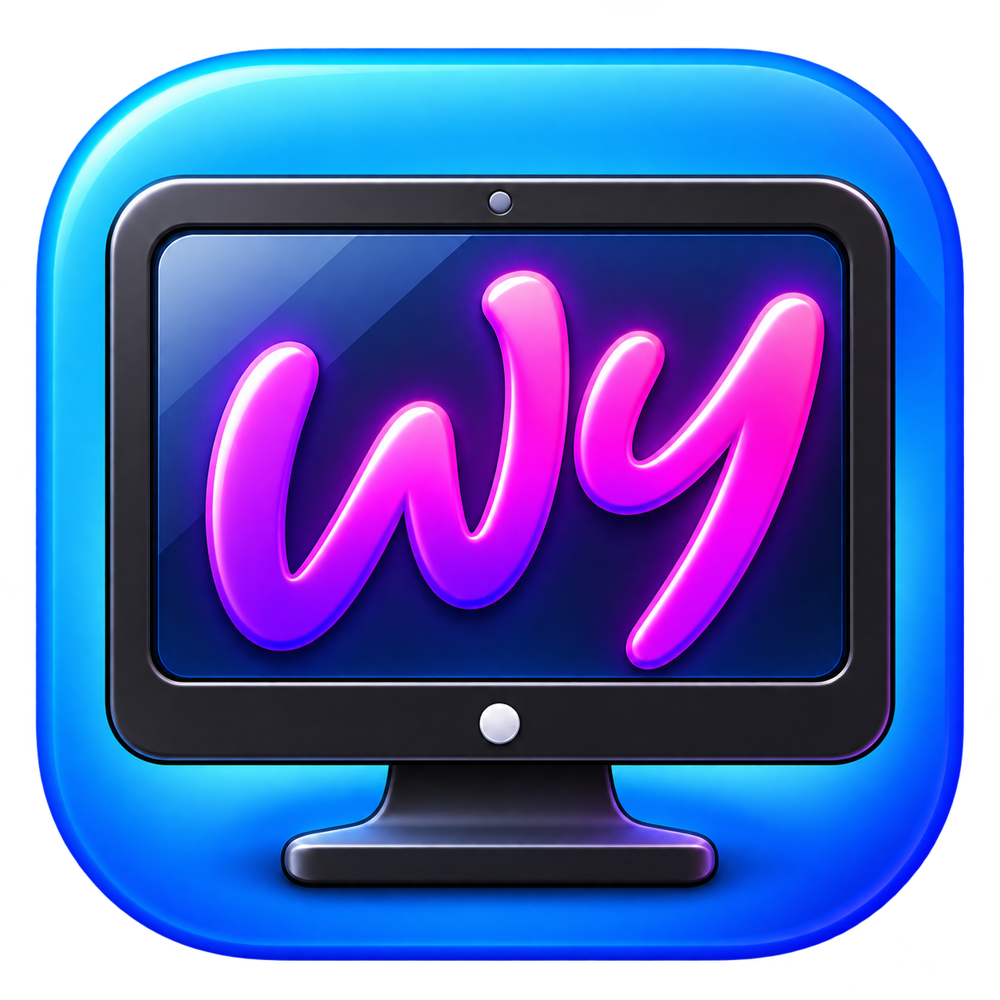

[English](README.md) | [Deutsch](README.de.md)

<p align="center"></p>
<h1 align="center">Wupsy</h1>

Wupsy brings animated wallpapers, a built-in wallpaper editor and desktop widgets to **macOS 14+ on Apple silicon**. Create and edit your own animated wallpapers, play videos, images, GIFs and local web content, and arrange widgets on your desktop. Wupsy is a native SwiftUI/AppKit app, originally based on Ambient and substantially extended with its own wallpaper editor and native scene features; see [license and origin](#license-and-origin).

**Early preview:** compatibility and performance are evolving. Development builds are ad-hoc signed, not Developer ID signed or notarized. No fixed CPU, memory or battery budget is promised.

## Features

- Original-quality looping video, with optional Balanced/Eco conversion and a bounded completed-copy cache.
- Native Flow, Ripple and Clouds image effects, Rain and CursorTrail layers.
- Built-in editor for native Wupsy projects, with masks, Flow direction/region painting, live preview, Undo/Redo, Save and Save As.
- Managed library imports, favorites, named playlists, manual backup and restore.
- Clock, date, CPU, estimated memory and network widgets; movable desktop layout and offline custom HTML/CSS widgets.
- Multiple displays, launch at login, sleep-aware playback and bounded video recovery.

## Built-in wallpaper editor

Start with your own PNG or JPEG image, or open an existing native Wupsy project. Arrange image layers, move, resize and rotate them, and add Flow for directional motion, Ripple for wave distortion or Clouds for animated cloud patterns. Paint masks to choose where supported effects appear, and paint Flow directions and regions to control movement. Rain and pointer-driven CursorTrail can be added as separate layers.

Use the static editing canvas to arrange the layout and Live Preview to check the animation. Undo/Redo lets you revise edits; Save and Save As keep your work as editable native projects. Imported originals remain unchanged. See [the editor guide](docs/EDITOR.md) for workflows and limitations. The editor works with native Wupsy scenes.

## Use Wupsy

Build from source below. In a disk-image distribution, copy Wupsy.app to Applications, wait for the copy, eject the disk image and open the copied app. If macOS blocks a build you trust, use its per-app Privacy & Security approval flow; never disable Gatekeeper globally.

Choose **Add wallpaper** in the library to import supported media, a web folder containing index.html, or a native folder containing scene.wss.json. Imports copy content into Wupsy's managed library and leave originals unchanged. Reimporting creates a separate copy. Removing a managed item deletes its local copy.

Closing the library does not stop playback; quit Wupsy from the menu bar to stop it.

Named playlists contain library entries; activation requires at least two distinct available wallpapers. Each playlist has its own interval and sequential/shuffle mode. Pause freezes rotation. Manual Apply or Stop disables rotation without deleting playlist definitions. Deleting a playlist never deletes its wallpapers.

For widgets, enable the desired widgets, choose **Edit on desktop**, arrange them and choose **Done**. Custom widgets use the [local widget package format](WIDGETS.md).

## Supported Wallpaper Formats

| Type | Formats | Support |
|---|---|---|
| Static images | PNG, JPEG / JPG, HEIC, TIFF | Static desktop wallpapers |
| Animated GIFs | GIF | Animated desktop wallpapers |
| Videos | MP4 | Looping video wallpapers with Original, Balanced and Eco quality |
| Local web wallpapers | HTML, CSS, JavaScript | Local HTML projects with animations, scripts and local resources |
| Native scenes | WSS (`scene.wss.json`) | Native scene editor, live preview and animated desktop rendering |

These formats have been tested in practice. GIF animation, MP4 playback with quality settings, and local web wallpapers were tested on macOS 26 and 27. PNG and JPEG were also tested with automatic wallpaper changes.

Video playback requires a codec that macOS can play; H.264/HEVC are recommended. The importer also accepts MOV and M4V, but these containers have not yet been practically verified.

**Media import is separate from scene editing.** The native WSS editor currently imports PNG and JPEG as image layers; importing other media does not make them editable scene layers.

Web wallpapers are local HTML files or project folders containing `index.html`, with CSS, JavaScript and local resources. They are not general-purpose browser windows. Scripts may access the network.

Start with the [project guide](PROJECT.md) for task-specific documentation. See [scene support](SCENE-SUPPORT.md), [scene format](WSS-SCENE-FORMAT.md), [effect index](WSS-EFFECTS.md) and [CursorTrail](WSS-TRAIL.md). Use only content you are permitted to use. Personal wallpaper photos and masks are not included.

## Data and backups

Wupsy uses `~/Library/Application Support/Wupsy`, `~/Library/Caches/Wupsy` and preference domain `com.wirdschonsoftware.wupsy`. It does not search or migrate Ambient data. Native imports are stored under `Wallpapers/WSS/`; media and web content use `Wallpapers/Media/` and `Wallpapers/Web/`.

Library backups are unencrypted and can contain private media, web sources and metadata. Keep them private. Restore replaces the library after confirmation, resolves open editors and requires quitting/reopening after publication. It does not automatically activate a backed-up wallpaper or playlist. See [backup format](BACKUP-FORMAT.md) and [restore safety](RESTORE-TRANSACTION.md).

## Build

Use Xcode with a Swift 6 toolchain selected by xcode-select:

```sh
swift test --jobs 2
bash scripts/build-app.sh
open dist/Wupsy.app
```

The package uses Swift 5 language mode and macOS system frameworks, including system libarchive. Packaging targets arm64; Intel distribution is not tested. Version is read from VERSION; build number is configured in scripts/config.sh.

For optional disk-image packaging, Python 3.10+ and the pinned layout tools are required:

```sh
python3 -m venv .venv
.venv/bin/pip install -r scripts/requirements-dmg.txt
LAYOUT_PYTHON="$PWD/.venv/bin/python" bash scripts/build-dmg.sh
```

See [distribution and signing](DISTRIBUTION.md). Development builds need no signing secrets. [Contributing](CONTRIBUTING.md) covers checks and code layout; [security guidance](SECURITY.md) covers reporting and content trust.

## License and origin

Wupsy is an independently developed fork of [Ambient](https://github.com/Claude-Reverser/Ambient), by Claude-Reverser and contributors. The original [MIT license and copyright](LICENSE) are retained. See [third-party notices](THIRD-PARTY-NOTICES.md) for current attribution and historical provenance limits.

The three specifically listed WSS branding graphics and their technical icon/background representations have separate usage rules: [Deutsch](BRANDING.md) / [English](BRANDING.en.md), with [Brand/LICENSE](Brand/LICENSE). Unchanged official apps, DMGs and unchanged official source copies may be redistributed with their graphics and notices. Modified builds/forks must replace or remove those official graphics unless separately permitted, subject to pre-existing rights. This does not restrict MIT-licensed code or retroactively restrict Ambient assets; no exclusive AI-art copyright or registered trademark is claimed.
