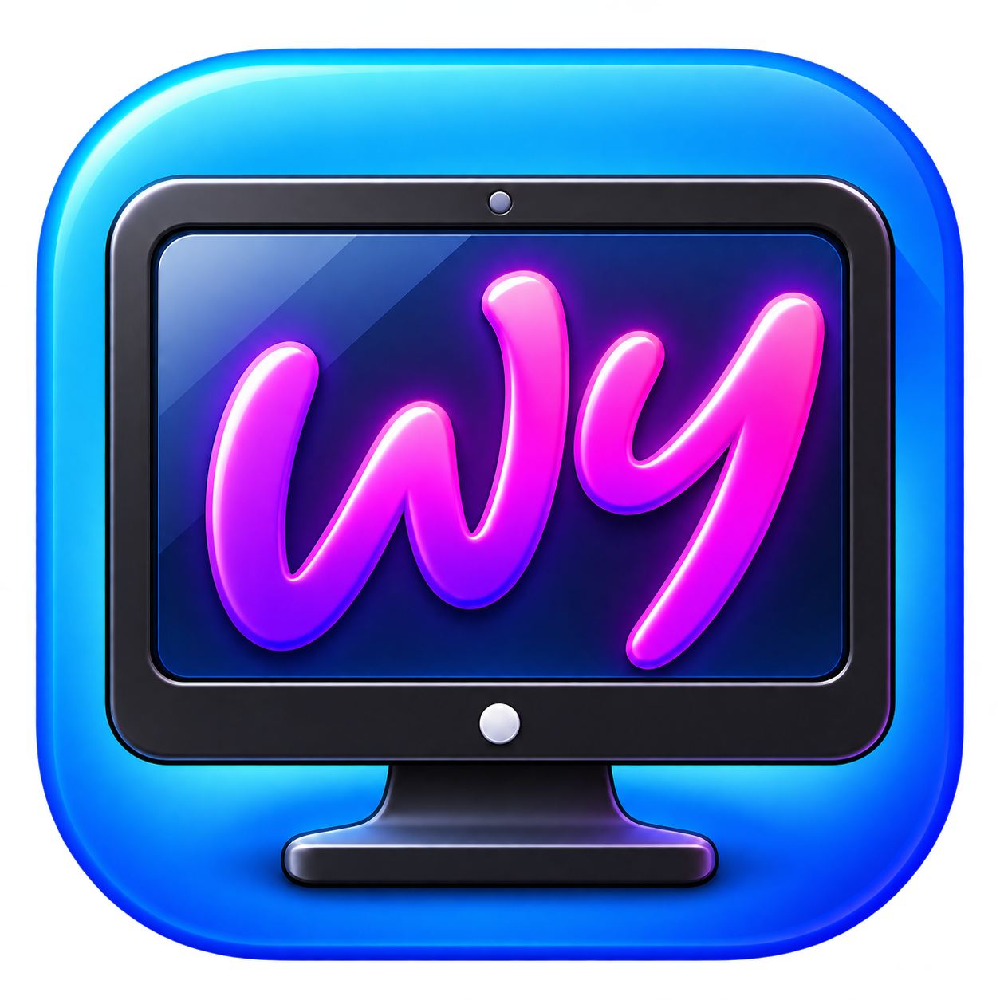

[English](README.md) | [Deutsch](README.de.md)

<p align="center"></p>
<h1 align="center">Wupsy</h1>

Wupsy is a native macOS app for animated desktop wallpapers, custom scenes and desktop widgets. Play videos, GIFs or local web projects, turn your own images into animated wallpapers in the built-in editor, and organize them in a library with favorites and playlists.

## Download and install

Wupsy requires **Apple silicon (ARM64)** and targets **macOS 14 or later**. Wupsy has been tested on macOS 26 and 27. macOS 14 and 15 have not been verified. The current download uses an ad-hoc signature and has no Apple Developer ID signature or notarization.

1. Download the `.dmg` and its matching `.dmg.sha256` file from the **Assets** section. [Latest GitHub release](https://github.com/Minischatten/Wupsy/releases/latest)
2. In Terminal, go to the folder containing both files and run the command below. Replace `<version>` with the version in the downloaded filename. Continue when the checksum reports `OK`.

   ```sh
   shasum -a 256 -c "Wupsy-<version>.dmg.sha256"
   ```

3. Open the disk image, copy `Wupsy.app` to **Applications**, wait for the copy to finish, then eject the disk image and open the copied app. If macOS blocks the app, you can approve it under **System Settings → Privacy & Security**.

You can also [build from source](#build).

## Library and desktop playback

- **Import and organize.** Use **Add wallpaper** or drop files into the library. Search and filter your collection, mark favorites, rename a selected wallpaper with Return, and drag cards to change their saved order. With the grid focused, the arrow keys move the selection and update the preview. The grid scrolls to keep the selection visible. Imports copy content into the managed library. Reimporting creates a separate copy. Removing a managed entry deletes its local copy.
- **Playlists.** Create named playlists with their own interval and sequential or shuffle playback. Activation requires at least two distinct available wallpapers. Pause holds the remaining interval. Explicitly activating a playlist clears manual pause. System pause conditions still apply. Applying a wallpaper manually or choosing Stop ends rotation and keeps the playlist definition. Deleting a playlist keeps its wallpapers in the library.
- **Playback.** Apply a wallpaper from the library and use Pause or Resume from the menu bar. Pause keeps the visible desktop frame for native WSS scenes, static images, videos and animated GIFs. Animations and videos resume from the frozen position. Local web wallpapers unload during pause and reload on resume. Library and editor previews run independently. Stop is available in the library. Closing the library window leaves playback running. Quit Wupsy from the menu bar to end it. For eligible image and WSS changes, Wupsy keeps the previous wallpaper if preparation fails. Video playback can make limited recovery attempts after a playback problem.
- **Displays and settings.** Play on the main display or enable **All Displays**. Playback responds to sleep, wake and display changes, including displays that temporarily disappear during wake. Settings include pause on battery, power saving, launch at login, update checks, and interface sizes of 100%, 125% and 150%. The library offers video quality and WSS resolution and frame-rate controls.
- **Performance diagnostics.** Use **Performance Diagnostics** in the library’s three-dot menu to inspect native WSS playback on a selected display. It shows frame rates and timings, with Wupsy process CPU, process memory and Metal memory in the expanded details. Measurement runs while the panel is open.

## Supported wallpaper formats

| Type | Files and projects | Playback |
| --- | --- | --- |
| Static image | PNG, JPEG / JPG, HEIC, TIFF | Static wallpaper |
| Animated GIF | GIF | Animated wallpaper |
| Video | MP4, MOV, M4V | Looping playback with Original, Balanced and Eco options |
| Local web | HTML file or folder containing `index.html` | HTML, CSS, JavaScript and local resources |
| Native WSS scene | Project folder containing `scene.wss.json`, or the manifest with its project assets | Native editor, live preview and animated desktop playback |

GIF animation, MP4 playback with quality settings, and local web wallpapers were tested on macOS 26 and 27. PNG and JPEG were also tested with automatic wallpaper changes. Video requires a macOS-compatible codec such as H.264 or HEVC. MOV and M4V are accepted by the importer and have not yet been tested. Balanced and Eco can create optimized copies in a size-limited cache.

Web wallpapers play local projects on the desktop. Their scripts may access the network. WSS projects require their referenced assets. WSS errors during import, wallpaper preparation or editor opening provide guidance and copyable technical details. Wallpaper Engine projects, PKG/TEX files and arbitrary external shaders are unsupported. Older Wupsy versions may reject scenes that use newer features. Use only content you have permission to use. Personal wallpaper photos and masks are not included. [Scene support](SCENE-SUPPORT.md) · [WSS format](WSS-SCENE-FORMAT.md)

## Built-in wallpaper editor

Create a WSS scene, open an existing project, or open a managed static wallpaper as an editable draft. The editor accepts PNG, JPEG, HEIC and TIFF files that contain exactly one image. It converts them to standard sRGB PNG. HDR and wide-gamut fidelity are lost in this conversion. The first save of a draft can add a new scene or replace the library entry while keeping its order, favorite status and playlist references. Imported originals remain intact.

Arrange, rename, show or hide layers. Move, resize and rotate image layers, adjust opacity, and combine image effects in an ordered stack. Paint masks for supported effects to choose where they appear. With Flow you can also paint movement directions and regions. Use the static canvas to arrange the scene and Live Preview to check animation. Undo and Redo let you revise edits. Use Smooth Anchor to align the handles of a selected Bézier anchor on a Music Notes path. Save updates the project, Save As creates an independent copy, and Revert restores the last saved scene. The macOS color panel can occasionally fail to pass a new Starfield color to the editor. [Editor guide](docs/EDITOR.md)

Use the gauge in Live Preview to open optional frame, CPU and memory diagnostics for the editor preview. Its measurements run independently of desktop diagnostics and stop when closed.

| Native effect or layer | What it does |
| --- | --- |
| **Flow** | Directional motion across an image, with paintable directions and regions |
| **Ripple** | Animated wave distortion in an image |
| **Clouds** | Animated cloud patterns on an image |
| **Fog** | A standalone fog layer between other layers, with adjustable density, softness, structure, height, color and drift. Paint or import a mask to reveal, hide or attenuate fog in parts of the scene |
| **Rain** | Animated rain in a configurable scene region |
| **Storm** | Lightning, with optional illumination of the full scene |
| **Starfield** | Stars with twinkle and drift, optional shooting stars and a procedural Milky Way |
| **Music Notes** | Animated notes and optional staff lines on straight, elliptical or editable Bézier paths, with depth relative to an image layer and perspective along open paths |
| **CursorTrail** | A trail that follows the pointer during live preview or playback and fades on its original display after the pointer leaves |

[Effect index](WSS-EFFECTS.md) · [Music Notes guide](docs/anleitungen/MUSIC-NOTES.md) · [CursorTrail](WSS-TRAIL.md)

## Desktop widgets

Add widgets for time, date, CPU usage, estimated memory use and network activity. Choose **Edit on desktop** to arrange enabled widgets, then choose **Done**. You can also create a local HTML/CSS widget and import or export its package. Custom widgets run offline. [Widget package guide](WIDGETS.md)

## Data and backups

Wupsy uses `~/Library/Application Support/Wupsy`, `~/Library/Caches/Wupsy` and the preference domain `com.wirdschonsoftware.wupsy`. It does not search for or migrate Ambient data. Native scenes are stored under `Wallpapers/WSS/`, media under `Wallpapers/Media/` and web wallpapers under `Wallpapers/Web/`.

Create and restore library backups from Settings. Backups are unencrypted and can contain private media, web sources and metadata. Store them privately. Restore replaces the library after confirmation, handles open editor sessions and requires restarting Wupsy. It leaves backed-up wallpapers and playlists inactive. Backups capture saved projects without unsaved editor drafts or Undo history. [Backup format](BACKUP-FORMAT.md) · [Restore safety](RESTORE-TRANSACTION.md)

## Build

For a source build, use Xcode with a Swift 6 toolchain selected by xcode-select. The build uses `swiftbuild` to compile localization resources:

```sh
swift test --build-system swiftbuild --jobs 2
bash scripts/build-app.sh
open dist/Wupsy.app
```

The package uses Swift 5 language mode and macOS system frameworks, including system libarchive. Packaging targets arm64; Intel distribution is not tested. Version is read from VERSION; build number is configured in scripts/config.sh.

For optional disk-image packaging, Python 3.10+ and the pinned layout tools are required:

```sh
python3 -m venv .venv
.venv/bin/pip install -r scripts/requirements-dmg.txt
LAYOUT_PYTHON="$PWD/.venv/bin/python" bash scripts/build-dmg.sh
```

See [distribution and signing](DISTRIBUTION.md). Development builds need no signing secrets. [Contributing](CONTRIBUTING.md) covers checks and code layout; [security guidance](SECURITY.md) covers reporting and content trust.

[Project guide](PROJECT.md) · [Architecture](docs/ARCHITECTURE.md)

## License and origin

Wupsy is an independently developed fork of [Ambient](https://github.com/Claude-Reverser/Ambient), by Claude-Reverser and contributors. The original [MIT license and copyright](LICENSE) are retained. See [third-party notices](THIRD-PARTY-NOTICES.md) for current attribution and historical provenance limits.

The three specifically listed WSS branding graphics and their technical icon/background representations have separate usage rules: [Deutsch](BRANDING.md) / [English](BRANDING.en.md), with [Brand/LICENSE](Brand/LICENSE). Unchanged official apps, DMGs and unchanged official source copies may be redistributed with their graphics and notices. Modified builds/forks must replace or remove those official graphics unless separately permitted, subject to pre-existing rights. This does not restrict MIT-licensed code or retroactively restrict Ambient assets; no exclusive AI-art copyright or registered trademark is claimed.
